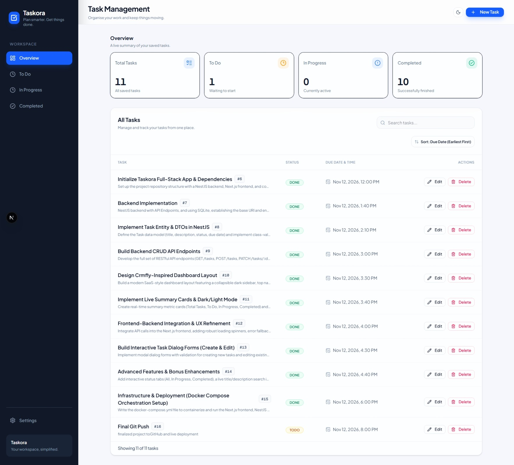
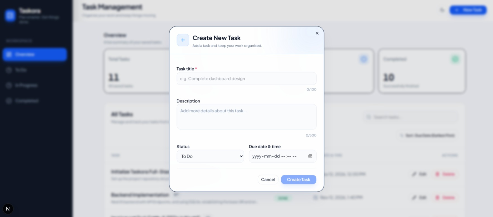
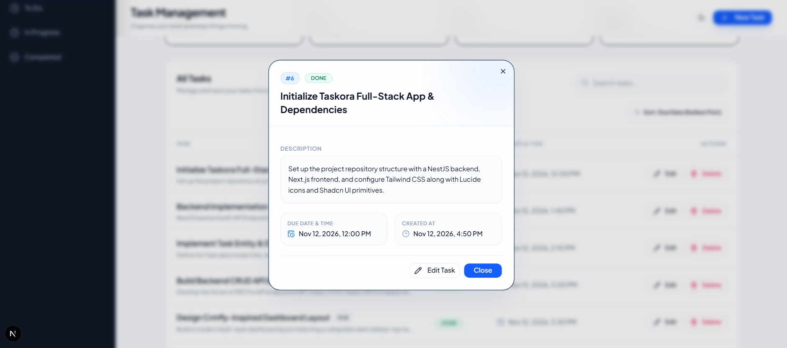

# Taskora - Full-Stack Task Management

Taskora is a full-stack task management application built with a **NestJS** backend (Prisma ORM + SQLite) and a **Next.js 16** frontend (Tailwind CSS + Shadcn UI). It provides a responsive dashboard for organizing tasks, tracking due dates, filtering by status, and managing workflows.

---
<sub>Author: GihanBandaraX · Published: November 12, 2026</sub>
---
## 📸 Application Screenshots

### Dashboard
<div align="center">
  
</div>

---

### Create New Task
<div align="center">
  
</div>

---

### View Task
<div align="center">
  
</div>

---
## 🛠️ Technology Stack

| Layer | Component | Technologies & Versions |
| :--- | :--- | :--- |
| **Backend (`/api`)** | Framework & Runtime | NestJS (`^12.0.1`), Node.js (ES Module format), TypeScript (`^6.0.2`) |
| | Database & ORM | Prisma ORM (`^6.19.3`), SQLite (`dev.db`) |
| | Validation & Testing | class-validator (`^0.15.1`), class-transformer (`^0.5.1`), Vitest (`^4.1.2`) |
| **Frontend (`/web`)** | Framework & Styling | Next.js (`16.4.6`), React (`19.3.0`), Tailwind CSS (`4.3.3`), TypeScript (`^5`) |
| | UI & Components | Shadcn (`^4.23.0`), Base UI (`^1.9.0`), Lucide Icons (`^1.72.0`), Sonner (`^2.0.8`) |

---

## 📁 Project Structure

```text
task-manager/
├── api/                   # NestJS Backend Application
│   ├── prisma/            # Prisma schema and SQLite database
│   ├── src/               # Controllers, modules, services, DTOs
│   └── ...
├── web/                   # Next.js Frontend Application
│   ├── src/               # App router pages, components, UI layout
│   └── ...
├── docker-compose.yml     # Multi-container orchestration setup
└── README.md
```

---

## ✨ Features Implemented

* **Full REST API:** Complete CRUD operations (`GET`, `POST`, `PATCH`, `DELETE`) for tasks with validation (`class-validator`).
* **Robust Data Handling:** SQLite persistent storage managed via Prisma ORM.
* **Modern Dashboard UI:** Built with Next.js 16, featuring a sidebar layout, live metrics summary cards, and dark/light mode toggle.
* **Interactive Modals:** Dialog workflows for creating, editing, and inspecting detailed task records.
* **Advanced Filtering & Sorting:** Filter tasks by status (`TODO`, `IN_PROGRESS`, `DONE`) synced with URL parameters, plus real-time search with clear functionality and ascending/descending due date sorting.
* **Overdue Highlights:** Visual warnings for tasks past their due date.
* **Docker Support:** Full containerized setup via Docker Compose.

---

## 🚀 Getting Started (From a Fresh Clone)

Follow these steps exactly to run the project locally.

### Prerequisites
* **Node.js:** Version 18.x or higher (Node.js 20+ recommended)
* **Package Manager:** npm (comes with Node.js)
* **Docker & Docker Compose:** (Optional, if running via containers)

---

### Method 1: Running Manually (Recommended for local development)

#### 1. Clone the Repository & Setup Backend (`/api`)
```bash
git clone https://github.com/GihanBandaraX/blue-harbor-task-manager.git
cd blue-harbor-task-manager/api
```

Install backend dependencies:
```bash
npm install
```

Configure environment variables by creating a `.env` file inside the `api` folder:
```env
PORT=3001
DATABASE_URL="file:./dev.db"
```

Run Prisma database migrations and generate the client:
```bash
npx prisma migrate dev --name init
```

Start the backend server:
```bash
npm run start:dev
```
*(The backend API will run on `http://localhost:3001`)*

---

#### 2. Setup and Run Frontend (`/web`)
Open a new terminal window and navigate to the `web` folder from the root:
```bash
cd blue-harbor-task-manager/web
```

Install frontend dependencies:
```bash
npm install
```

Configure environment variables by creating a `.env.local` file inside the `web` folder:
```env
NEXT_PUBLIC_API_URL=http://localhost:3001
```

Start the frontend development server:
```bash
npm run dev
```
*(The web application will run on `http://localhost:3000`)*

---

### Method 2: Running with Docker Compose (Bonus)
From the root project directory (`/blue-harbor-task-manager`), run:
```bash
docker compose up --build
```
This will spin up both the NestJS API container and the Next.js frontend container simultaneously.

---

## 🤖 How I Used AI

During the development of Taskora, AI assistant tools were utilized to accelerate boilerplate setup, structure validation DTO pipes in NestJS, and refine responsive Tailwind/Shadcn component styles in Next.js.

**Modifications & Customizations applied to generated code:**
* **Database Layer Customization:** Replaced generic MongoDB/Mongoose models suggested by default AI templates with a lightweight, file-based **SQLite database via Prisma ORM** to meet self-contained local evaluation requirements.
* **Next.js 16 Routing Adaptation:** Refactored client-side search parameter hooks (`useSearchParams`) to integrate with proper `<Suspense>` boundaries and resolve prerendering/blocking build constraints in Next.js 16.
* **UI/UX Refinement:** Customized the dashboard color palette, badge states, and interactive view/edit dialog flows to match a clean, Crmfly-inspired SaaS dashboard aesthetic.
